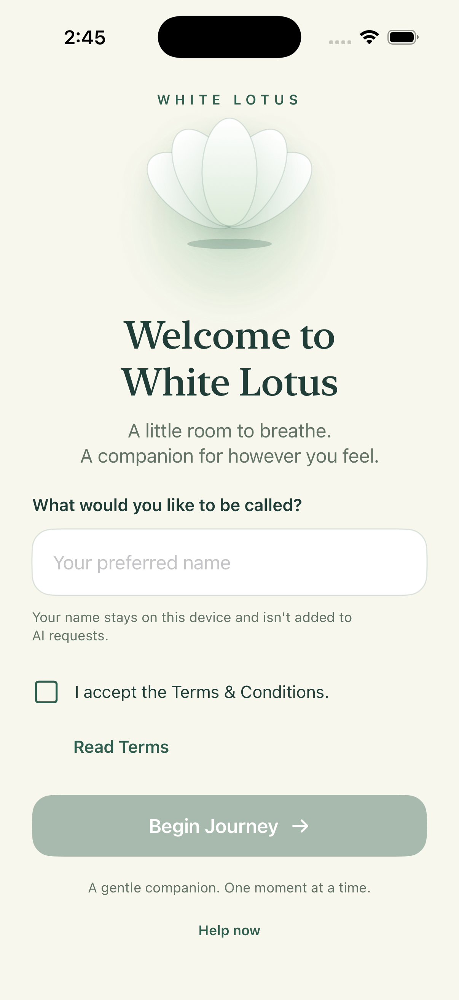
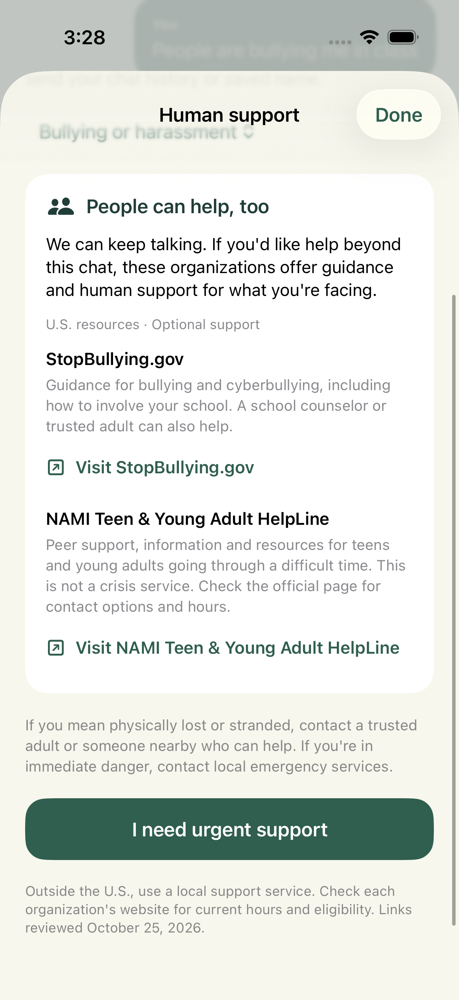

# White Lotus

A native SwiftUI wellness companion for students who want a place to vent, take a grounding pause, enjoy a lighthearted break, or find a manageable next step.

White Lotus offers four companion styles, a local mindfulness reference for Teacup, on-device conversation archives, and access to human-support resources. It is a general wellness prototype, not a therapist or medical service. AI replies are generated by Google's Gemini API; local archives do not mean that AI processing happens offline.

## The companions

| Companion | Purpose | Example prompt |
| --- | --- | --- |
| 🍵 **Teacup — Find Your Center** | Gentle grounding using the app's bundled mindfulness guide | “My mind is racing before a presentation. Walk me through one short grounding exercise.” |
| 🧺 **Basket — Let It Out** | Empathy and validation when someone wants to be heard | “A friend left me out of a group plan. I feel hurt and just want to be heard.” |
| 🪃 **Boomerang — Need a Laugh?** | Clean jokes and playful conversational distraction | “Tell me a clean school joke, then give me a silly would-you-rather.” |
| 🏮 **Lantern — Find Your Spark** | Breaking overwhelming tasks into small actions | “I have three tests tomorrow. Give me one five-minute step to get started.” |

All four companions use the same configured model with different persona instructions. Their intended behavior is guided by prompts rather than separate model training.

## Screenshots

| Welcome and onboarding | Teacup human-support directory |
| --- | --- |
|  |  |

## Features

- **Welcome and consent:** Glowing lotus, preferred-name entry, readable terms, and Begin Journey enabled only after a name and checked consent.
- **Personalized dashboard:** Four themed companion cards, expandable Learn More descriptions, Settings, and Help now.
- **Contextual chat:** Active-session conversation history, starter prompts, multiline input, selectable messages, loading indicators, and retry/edit controls.
- **Teacup grounding:** Runtime loading of three practices from `Resources/mindfulness_data.txt`: five-senses grounding, STOP, and gentle paced breathing.
- **Local safety check:** Keyword interception before saving a triggering draft or sending it to Gemini, with a separate urgent-support screen.
- **Optional human support:** Teacup cards and a browsable directory for bullying, loneliness, feeling emotionally lost, and practical needs. Links point to StopBullying.gov, NAMI resources, and United Way 211.
- **Local archives:** Atomic JSON snapshots, iOS complete file protection, archive backup exclusion, and confirmed deletion in Settings.
- **Start fresh:** **Settings → Your space → Start fresh → Log out** returns to welcome and clears the saved name and consent while retaining chat archives.
- **Reply recovery:** Bounded server retries and explicit handling of truncated responses, quota, connectivity, configuration, and provider errors.

## Requirements

- A Mac with Xcode and an installed iOS Simulator runtime.
- Deployment target: **iOS 16.0 or later**; configured for iPhone and iPad.
- Internet access and your own Gemini API key for generated AI replies.
- An Apple signing team and a supported iPhone for physical-device installation.

No third-party Swift packages, Python runtime, project generator, or database server is required. Recorded simulator verification used Xcode 26.5 and iOS 26.5; not every supported OS version or physical-device action has been tested.

## Quick start

```sh
git clone https://github.com/pavik11/White-Lotus.git
cd White-Lotus
open MentalWellness.xcodeproj
```

Select the **MentalWellness** scheme and an iPhone simulator, then press **⌘R**.

The project builds without a secret config file. Onboarding, local screens, and safety interception are available without an API key; generated chat replies show a configuration error until a working key is provided.

## Configure Gemini without publishing your key

Choose either method below. Do not paste a real key into Swift source, a shared scheme, an issue, or a commit.

### Option A: Private local configuration

This method also works when opening the installed app directly from the iPhone Home Screen.

```sh
cp -n Config/Secrets.example.xcconfig Config/Secrets.local.xcconfig
```

Open **`Config/Secrets.local.xcconfig`** locally and set:

```xcconfig
WHITE_LOTUS_GEMINI_API_KEY = your_key_here
```

The local file is ignored by Git. The public `Config/App.xcconfig` optionally includes it. `Config/Info.plist` references the build variable so Xcode can place its value in the generated app Info.plist. `Services/Secrets.swift` reads that value; it contains no real credential.

### Option B: Xcode Run environment variable

In **Product → Scheme → Edit Scheme → Run → Arguments → Environment Variables**, add **`GEMINI_API_KEY`** with your key. This takes precedence over the bundled local setting, including when the environment value is blank.

Run-scheme variables apply when Xcode launches the app. For Home Screen launches, use Option A. Keep key-bearing settings in your personal scheme/user data, not the shared scheme tracked in this repository.

### Model configuration

The source default is **`gemini-3.6-flash`** in `GeminiConfiguration.defaultModel`. To choose another model your Google project can access, set **`GEMINI_MODEL`** in your private Run environment. Bare model IDs and `models/` resource names are accepted; blank model overrides use the source default.

Model access, quotas, and availability depend on the Google project. Listing a model does not guarantee that it can generate a reply. Reference: [Gemini API documentation](https://ai.google.dev/gemini-api/docs).

### What is hidden from GitHub?

The [`.gitignore`](.gitignore) excludes the following local/private files and generated outputs:

| Ignored file or pattern | Why it is excluded |
| --- | --- |
| **`Config/Secrets.local.xcconfig`** and other `Secrets.local.xcconfig` files | Your real local Gemini API key |
| `.env`, `.env.*`, `*.local.env` | Local environment credentials; `.env.example` is allowed as a public template |
| `**/xcuserdata/`, `*.xcuserstate` | Personal Xcode schemes, local run variables, and editor state |
| `*.xccheckout`, `*.xcscmblueprint` | User-specific Xcode source-control metadata |
| `DerivedData/`, `build/`, `.build/` | Generated build caches |
| `*.app/`, `*.ipa`, `*.xcarchive/`, `*.dSYM/`, `*.dSYM.zip` | Build/export artifacts, which can include the locally configured key |
| `*.xcresult/` | Local test results, logs, and recordings |
| `*.p12`, `*.p8`, `*.key`, `*.pem`, `*.mobileprovision`, `*.provisionprofile` | Private signing material and provisioning files |
| `WellnessChats/`, `WellnessUITestChats/` | Chat data if copied into the project for troubleshooting |
| `.DS_Store`, `.AppleDouble`, `.LSOverride`, `.vscode/`, `.idea/`, swap/backup files | Machine-specific metadata and local editor configuration |

**Published intentionally:** `Config/Secrets.example.xcconfig` is blank; `Config/App.xcconfig` and `Config/Info.plist` contain variable references only; `Services/Secrets.swift` contains the safe loader and model configuration. The shared Xcode scheme, application sources, tests, assets, and documents are included so a fresh clone can build.

To check the local key file yourself:

```sh
git check-ignore -v Config/Secrets.local.xcconfig
git ls-files Config/Secrets.local.xcconfig
```

The first command should identify an ignore rule. The second should print nothing. Ignoring a file does not remove a secret that was previously committed; review staged changes before committing.

A local key is still recoverable from a compiled demo app. Keeping it out of Git protects the repository, not the distributed binary. Production distribution needs an appropriate credential/backend design rather than a developer's embedded key.

## Run on your iPhone

1. Connect and unlock your iPhone; trust the Mac when prompted.
2. Sign into your Apple Account in Xcode Settings.
3. Select the **MentalWellness** target → **Signing & Capabilities**, enable automatic signing, and choose your team. Use a unique bundle identifier if required for your account.
4. Select your physical iPhone as the run destination.
5. Enable Developer Mode on the phone when requested and follow its restart/confirmation prompts.
6. Press **⌘R** to install and launch.

For AI replies after disconnecting from Xcode, configure the ignored local file before building. Choose your own signing settings; signing identities are not supplied by this repository.

## How Teacup uses its mindfulness guide

`MindfulnessDataLoader` reads the bundled UTF-8 guide at runtime. The app inserts the complete text into Teacup's system instruction and instructs Gemini to suggest only those exercises. Missing or empty data blocks a Teacup request before network access.

This is whole-document grounding/RAG-style context injection. It does **not** fine-tune Gemini or use embeddings, a vector database, or semantic passage search. The guide is a small educational resource with sourcing notes, not evidence of clinical validation or source endorsement.

## Privacy, memory, and human support

- The saved preferred name is used in the interface and is not automatically attached to AI requests. What a user types can still identify them.
- Gemini receives message text, active conversation history, and the system instruction to generate replies. [Google's Gemini API policies](https://ai.google.dev/gemini-api/terms) apply to submitted content.
- Conversation archives are stored locally. Returning to the dashboard cancels the request and clears active memory; it does not delete archives.
- New companion sessions do not receive older companions' archived conversations. There is currently no archive-browser or resume-old-chat UI.
- The keyword scanner is a limited hardcoded check, not clinical risk assessment. It can miss danger or flag ordinary phrases. Help now is available without waiting for it to match.
- Triggered drafts are neither saved nor submitted. The urgent-support screen offers verified U.S. 988 call, SMS, and online-chat actions; it never contacts anyone automatically.
- Teacup's optional resources are U.S.-scoped and app-owned links. Their official pages provide current eligibility and hours. Opening a resource does not put chat text or the saved name into its URL.
- Deleting local archives does not request deletion of content previously submitted to Google.

## Service resilience

The client starts with a 4,096-token allowance and LOW thinking for the default model. If Gemini returns `MAX_TOKENS`, it regenerates the same turn once at 8,192 tokens. A second truncation becomes an explicit retryable error instead of a successful partial assistant message.

HTTP 500/502/503/504 responses receive up to two retries per generation request with backoff and jitter. Short Retry-After cooldowns are respected. Quota, credential, model, safety, and decoding errors have distinct handling and do not receive those automatic HTTP retries. Pending work is cancelled when the active session ends.

These mechanisms cannot eliminate Google outages, exhausted quota, or connectivity problems. The app does not silently switch models or generate offline fallback replies.

## Tests

Use **Product → Test** in Xcode, or select an available simulator for terminal execution:

```sh
xcodebuild test \
  -project MentalWellness.xcodeproj \
  -scheme MentalWellness \
  -destination 'platform=iOS Simulator,name=YOUR_SIMULATOR_NAME' \
  CODE_SIGNING_ALLOWED=NO
```

Tests use mocked responses and do not need a Gemini key. Debug UI automation uses an isolated preference suite and a temporary chat directory, preserving the normal app's profile and archives.

Recorded checks include 27 unit/service tests and UI flows for onboarding, urgent support, Teacup resources, and logout/re-onboarding. See [verification notes](VERIFICATION.md) for the exact runs, simulator limits, and live-provider results.

## Project structure

```text
MentalWellnessApp.swift          App entry point and onboarding routing
MentalWellness.xcodeproj/        Xcode project and shared scheme
Config/                         Public build config and blank secrets template
Models/                         Personas, messages, sessions, resource catalog
ViewModels/                     Chat state, lifecycle, and safety-first sending
Services/                       Gemini client, local storage, safety, guide loading
Views/                          Onboarding, dashboard, chat, settings, human support
Resources/                      Mindfulness guide, assets, and privacy manifest
Tests/                          Service, view-model, persistence, safety, and UI tests
Previews/                       Demo screenshots
```

## More detail

- [Complete feature rundown](WHITE_LOTUS_FEATURE_RUNDOWN.md)
- [Demo prompts and presentation guide](DEMO_GUIDE.md)
- [Verification record](VERIFICATION.md)
- [Original product requirements](PRD.md)
- [Original persona requirements](AGENTS.md)

The original requirements document some earlier designs and model names. The current source, setup instructions above, and feature rundown describe the implemented prototype.
